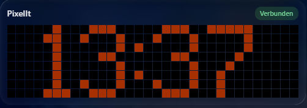
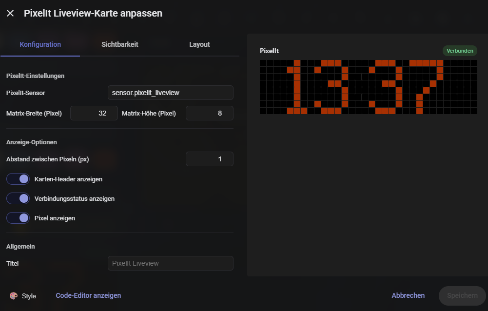

# PixelIt Liveview

A custom **Home Assistant integration** that mirrors the live content of a [PixelIt](https://github.com/pixelit-project/PixelIt) matrix display — the clock, bitmaps, text, everything you see on the physical display — as a mini pixel grid on a Lovelace card.

Unlike a naive direct-connection approach, this reads the display content **through Home Assistant**, so it works everywhere: on the desktop, in the Companion App over **Nabu Casa (remote/https)**, and on any network.

## Features

- **Live pixel mirror** — Shows exactly what the PixelIt display is currently showing (rendered from the real LED pixels, ~250ms updates)
- **Works over Nabu Casa / remote** — Uses a HA sensor, not a direct device WebSocket, so it works in the Companion App and from outside your LAN
- **Self-healing connection** — Automatically reconnects if the PixelIt WebSocket goes stale (e.g. after a color change in the PixelIt WebUI)
- **Automatic card registration** — The Lovelace card is registered as a resource automatically, no manual setup
- **Config flow** — Configure IP, port and matrix size via the HA UI, no YAML editing
- **Theme-compatible** — Transparent background, adapts to any HA theme (including glass/Frosted Glass themes)
- **Connection status badge** — Shows "Connected" / "Disconnected"
- **Multi-language** — English and German UI (auto-detects HA language)

## Installation

### HACS (recommended)

1. Add this repo as a custom repository in HACS (type: **Integration**)
2. Install
3. Restart Home Assistant
4. **Settings → Devices & Services → Add Integration → PixelIt Liveview**
5. Enter the PixelIt IP, port and matrix size
6. Add the card to your dashboard (it's auto-registered as a resource)

### Manual

1. Copy the `custom_components/pixelit_liveview/` folder to your `config/custom_components/`
2. Restart Home Assistant
3. **Settings → Devices & Services → Add Integration → PixelIt Liveview**
4. Enter the PixelIt IP, port and matrix size
5. Add the card to your dashboard

## Configuration

The integration is configured via the **config flow** (HA UI), no YAML needed. When you add the integration you are asked for:

| Field | Description |
|-------|-------------|
| **PixelIt display IP address** | The IP of your PixelIt (e.g. `192.168.178.8`) |
| **WebSocket port** | Default `81` |
| **Matrix width in pixels** | Width in pixels (e.g. `32`) |
| **Matrix height in pixels** | Height in pixels (e.g. `8`) |

> Note: The labels are shown in German if your Home Assistant language is German, otherwise in English.

### Card Options

| Option | Type | Default | Description |
|--------|------|---------|-------------|
| `entity` | string | `sensor.pixelit_liveview` | Sensor exposing the liveview data |
| `width` | int | 32 | Matrix width in pixels |
| `height` | int | 8 | Matrix height in pixels |
| `gap` | int | 1 | Gap between pixels (px) |
| `title` | string | `PixelIt` | Card title |
| `show_header` | bool | true | Show card title |
| `show_status` | bool | true | Show connection status badge |
| `show_pixels` | bool | true | Show the pixel grid |

## How it works

1. The integration opens a WebSocket to `ws://<pixelit-ip>:81`.
2. PixelIt streams its live pixels as `{"liveview":"<hex>"}` (~6 hex chars per pixel, row by row).
3. The integration parses the hex into `{r,g,b}` pixels and writes them to the `sensor.pixelit_liveview` attributes.
4. The card reads the sensor via HA and renders the pixels as a grid, stretching to fill the card width while keeping pixels square.

## License

MIT
